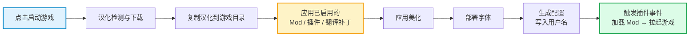

<a id="top"></a>

<div align="center">


# FaustLauncher

**《边狱巴士》一体化启动器 —— 汉化 · 美化 · Mod · 插件 · 成就，一次点击全部就位**

[](https://github.com/f0lkskill/FaustLauncher/releases)
[](#stack)
[](LICENSE)
[](https://github.com/f0lkskill/FaustLauncher/stargazers)
[](https://github.com/f0lkskill/FaustLauncher/releases)

[这是什么](#about) · [功能特性](#features) · [界面预览](#preview) · [快速开始](#quickstart) · [工作原理](#how) · [二次开发](#dev) · [常见问题](#faq) · [更新日志](https://github.com/f0lkskill/FaustLauncher/releases)

</div>

<p align="center">
  
</p>

---

<a id="about"></a>

## 📖 这是什么

**FaustLauncher** 是《边狱巴士 (Limbus Company)》玩家的一体化启动器：把**汉化更新、游戏美化、Mod 与插件管理、自定义翻译、版本自动更新**收进一个界面，点一次「启动游戏」就全部处理完。

它不是一个「把官网链接摆一排」的导航页 —— 而是真正动手处理游戏文件的那一层：下载汉化包、按需改写 `Lang` 文本、搬运资源、加载 Mod、最后把游戏拉起来。

<p align="center">
  <a href="https://github.com/f0lkskill/FaustLauncher"></a>
  <a href="https://github.com/f0lkskill/FaustLauncher"></a>
  <a href="https://github.com/f0lkskill/FaustLauncher"></a>
  <a href="https://github.com/f0lkskill/FaustLauncher"></a>
</p>

> [!NOTE]
> 所有对游戏的操作都是**可逆的**：被禁用的补丁会自动还原它改过的文本；顶层数据目录（`config` / `lang` / `mods` / `addons`）在更新时只做合并覆盖，绝不清空。

<a id="features"></a>

## ✨ 功能特性

<table>
<tr>
<td align="center" width="25%">🚀<br><b>一键启动</b><br><sub>汉化 → 补丁 → 美化 → 字体 → 启动<br>一次点击全自动</sub></td>
<td align="center" width="25%">🌐<br><b>汉化自动更新</b><br><sub>4 种下载源自动回退<br>版本自动比对</sub></td>
<td align="center" width="25%">🎨<br><b>界面美化</b><br><sub>气泡渐变 · 技能名罪孽色<br>EGO 名称 · Tip · 字体</sub></td>
<td align="center" width="25%">🧩<br><b>Mod + 插件</b><br><sub>自带 Mod 加载器<br>可自写插件与补丁</sub></td>
</tr>
<tr>
<td align="center">📝<br><b>自定义翻译</b><br><sub>可视化改写任意文本<br>生成可移植补丁</sub></td>
<td align="center">🏆<br><b>成就系统</b><br><sub>观测战斗事件并弹窗<br>偏移索引随版本适配</sub></td>
<td align="center">🖼️<br><b>皮肤系统</b><br><sub>玻璃窗换肤<br>带解锁条件</sub></td>
<td align="center">🛠️<br><b>工具集</b><br><sub>文件夹超链接 · 字体 · 渐变文本<br>CDN 优选 · 今日指令</sub></td>
</tr>
</table>

还包含：**跨设备账号同步**（用户 ID 即账号，皮肤解锁状态跟着走）、**温和的自动更新**（支持预发布版，先落地新目录再切换，任何一步失败都不破坏当前安装）、**多平台汉化源**（零协会 / OurPlay 普通版 / OurPlay 神人版）。

<a id="preview"></a>

## 🖼️ 界面预览

| 主界面 | 插件与 Mod 管理 | 社区下载中心 |
|:---:|:---:|:---:|
|  |  |  |

| 关于界面 | 个性化设置 | 工具组 |
|:---:|:---:|:---:|
|  |  |  |

<a id="quickstart"></a>

## 🚀 快速开始

1. 到 [Releases](https://github.com/f0lkskill/FaustLauncher/releases) 下载最新版，解压到**不需要管理员权限**的目录。
2. 双击 `FaustLauncher.exe`。
3. 在「设置」里确认**游戏安装路径**指向 `LimbusCompany.exe` 所在目录。
4. 回主页点 **「启动游戏」**，等它自动完成汉化更新并拉起游戏。
5. 可选：在「设置」调美化 / 音效 / 主题，在「玻璃窗」换皮肤。

> [!IMPORTANT]
> 游戏路径必须指向 `LimbusCompany.exe` 所在的那一层目录。路径不对时启动流程会直接停下来提示，不会去动别的文件。

> [!TIP]
> 更新提示可以在「关于」里查看；启动器的自动更新**只替换运行时目录**，你的设置、Mod、汉化都留在原地。

<details>
<summary>🖥️ 从源码运行 / 自己打包（点开）</summary>

```bash
git clone https://github.com/f0lkskill/FaustLauncher.git
cd FaustLauncher
pip install -r requirements.txt

# 素材（图标 / 音效 / 背景 / 皮肤图片）不在仓库里，先拉一次：
tools\run\assets.bat fetch

python main.py            # 默认 Web 界面；--tk-ui 回旧界面，--debug 开调试输出
```

打包：`python tools/build/build.py`（可视化构建工具），或直接用 PyInstaller 跑 `tools/build/FaustLauncher.spec`。

</details>

<a id="how"></a>

## ⚙️ 工作原理

点一次「启动游戏」，后端按固定顺序跑完这条流水线：



- **被禁用的东西会自动还原**：资源被关掉时，它之前改过的游戏文本会按快照回滚，不会留下"禁用还在生效"的残留；
- **失败不阻塞**：非关键步骤失败只记日志继续；关键步骤（汉化复制 / 字体）失败会明确弹窗；
- **成就的战斗观测**走只读注入：读取战斗事件用于解锁提示，不修改游戏数据，可随时在设置里关闭。

<details>
<summary>📋 8 步流水线各自做什么（点开）</summary>

| 步骤 | 内容 |
|:---:|:---|
| 1 | 汉化下载更新（多源自动回退 + 版本比对） |
| 2 | 复制汉化文件到游戏目录 |
| 3 | 应用**已启用**的 Mod / 插件 / 自定义翻译补丁；被禁用的自动还原 |
| 4 | 应用美化（气泡 / 技能 / EGO / Tip） |
| 5 | 部署字体 |
| 6 | 生成零协会配置 |
| 7 | 写入用户名（`UserInfo_Friends.json`，可在设置里关掉） |
| 8 | 触发插件启动事件 + 加载 Mod + 拉起游戏 |

</details>

<a id="stack"></a>

## 🧰 技术栈

| 层 | 技术 |
|:---|:---|
| **界面** | pywebview 6.2（WebView2）+ 原生 HTML / CSS / JavaScript，**无前端框架**；模块按 `core → ui → features → app` 分层 |
| **后端** | Python 3.14（标准库 + `requests` / `Pillow`） |
| **进程间** | pywebview `js_api` 双向桥；多窗口以 `main.py --xxx-window` 子进程拉起 |
| **打包** | PyInstaller（onedir），运行时收在 `_internal/` |
| **更新** | Windows Script Host（`updater.vbs`） |
| **游戏资源** | UnityPy · texture2ddecoder · astc-encoder · etcpak · fmod_toolkit · pyfmodex |
| **逆向 / Hook** | capstone · pefile · pythonnet（偏移索引、元数据恢复、战斗事件观测） |
| **目标平台** | Windows 10 / 11 |

<a id="structure"></a>

## 📁 项目结构

```text
FaustLauncher/
├─ main.py                    # 入口（默认 Web UI；各独立窗口以 --xxx-window 子进程拉起）
├─ tools/                     # 开发与排障工具（见 tools/README.md）
│  ├─ build/                  #   构建工具 + PyInstaller spec + 素材资源包脚本
│  ├─ build_temp/             #   打包输入（版本更新器）
│  ├─ dev/ diag/ run/ doc/    #   小脚本 / 排障脚本 / .bat 快捷方式 / 开发文档
│  └─ preview/ wiki_fetch/    #   界面预览图 / 图标抓取（本地产物，不入库）
├─ web/                       # 前端
│  ├─ app/                    #   主界面：index.html + css + js(core/ui/features)
│  └─ app_skins/              #   皮肤（css / config 在仓库，图片在素材包里）
├─ functions/                 # 后端
│  ├─ base/                   #   基础设施：设置、网络配置、账号、JSON 读写、路径
│  ├─ pages/                  #   各界面窗口（pywebview 桥接 + 独立窗口）
│  ├─ web_update/ webFunc/    #   云端数据、下载源与缓存
│  ├─ fancy/                  #   游戏美化（气泡 / 技能 / EGO / Tip）
│  ├─ modloader/              #   Mod 加载（bank 音频、贴图重打包）
│  ├─ hook/ achievement/      #   偏移索引、成就与战斗事件观测
│  ├─ translate/ tools/       #   翻译与扩展工具
│  └─ update/                 #   版本更新流程
├─ assets/                    # 素材（图片 / 语音）——不在仓库里，用资源包分发
├─ config/                    # settings.json（用户设置）/ web_config.json（云端地址）
├─ resources/                 # 运行期资源（启动器自动下载，不入库）
└─ previews/                  # README 截图与图标
```

<a id="dev"></a>

## 🛠️ 二次开发

| 需求 | 入口 |
|:---|:---|
| 写插件 | [MakeAnAddon.md](tools/doc/MakeAnAddon.md) —— 启动事件钩子、`changes.json` 文本补丁、资源打包 |
| 写皮肤 | 复制 `web/app_skins/faust/`，改 `css/style.css` 与 `config.json`（皮肤图片属于素材资源包） |
| 素材资源包 | `tools\run\assets.bat [pack\|status\|fetch\|upload]` —— clone 之后先 `fetch`，否则图标/音效/背景是空的 |
| 打包发布 | `python tools/build/build.py` |
| 云端排障 | `python tools/diag/webnote_diag.py` |
| 工具索引 | [tools/README.md](tools/README.md) —— 每个脚本干什么、怎么跑 |

> 维护约定：前端改动后请同步提升 `web/app/index.html` 里资源引用的 `?v=NN` 缓存版本号；所有 JS 文件共享同一全局作用域，新增模块请追加到入口之前。

<a id="faq"></a>

## ❓ 常见问题

<details>
<summary>启动器被安全软件拦了 / 进程被杀</summary>

启动器需要读写游戏目录、并做只读的内存观测，容易被误判。请把安装目录加入杀软白名单后重试；如果只是不想用成就与战斗观测，可以在设置里关掉它，不影响其它功能。
</details>

<details>
<summary>刚更新完游戏，第一次启动明显变慢</summary>

游戏更新后需要重新适配偏移索引。这一步会占用 CPU 与磁盘，因此**排在游戏退出之后**做，避免和游戏抢资源；适配完成后后续启动就恢复正常。
</details>

<details>
<summary>成就 / 战斗观测没有生效</summary>

先确认设置里「启用成就监测与战斗观测」是打开的，再看 `logs/achievement_hook.log`（成就与观测日志已经合并成这一份）。
</details>

<details>
<summary>改了用户名但没有变化</summary>

昵称修改有 **1 小时冷却**（服务端同样有一道硬校验），冷却结束或切换到其它账号后即可再次修改；「显示用户名」开关关闭时，游戏里那处文本会还原成原文。
</details>

<details>
<summary>汉化包下载失败</summary>

在「设置 → 翻译下载方式」里换一种源再试（内置 4 种，会自动回退）。国内线路不通时优先用蓝奏云转存源。
</details>

<details>
<summary>源码运行报"找不到素材"</summary>

素材不在仓库里。跑一次 `tools\run\assets.bat fetch` 把资源包合并进来即可，详见 [tools/README.md](tools/README.md)。
</details>

<a id="credits"></a>

## 🤝 贡献者

| 头像 | 姓名 | 角色 | 贡献 |
|:---:|:---|:---|:---|
|  | **FolkSkill** | 项目创始人 & 主开发者 | 整体架构设计与全部核心功能（2025-11-25 立项） |
|  | **HZBHZB1234** | 项目程序贡献者 | 开发早期的部分代码贡献与流程指导，LCTA 作者 |
|  | **尘** | 项目程序贡献者 | LC Mod Loader 手机版作者，贡献 rebank 加载机制 |
|  | **Bob** | 项目程序贡献者 | 修复自定义汉化的递归问题 |
|  | **里诺Ariko** | 民间有色战斗气泡文本作者 | 持续为启动器提供有色战斗气泡文本 |
|  | **零协会** | 汉化支持 | 都市零协会汉化组官方本地化项目 |
|  | **社区贡献者** | 测试 & 反馈 | 使徒 · HZB · 尘 · 海螺 · 庭渡久歌 · 终末之影 · 四季交融 · 快乐咸鱼君 · 盘 等 |

**反馈渠道**：[Bug 反馈](https://github.com/f0lkskill/FaustLauncher/issues/new?template=bug_report.md) · [功能建议](https://github.com/f0lkskill/FaustLauncher/issues/new?template=feature_request.md) · [讨论区](https://github.com/f0lkskill/FaustLauncher/discussions)

---

## 📜 免责声明（必读）

> [!WARNING]
> 使用本软件即视为您已阅读并同意以下全部内容。

1. **软件性质**：开源免费，仅限学习、研究与个人交流，禁止商业用途。
2. **版权归属**：《边狱巴士 (Limbus Company)》及其素材版权归 **Project Moon** 及相关权利方；汉化文本版权归**零协会汉化组**等原权利人。本项目不含盗版内容，请确保您已购买正版游戏。
3. **修改风险**：本软件会自动写入与修改游戏本地化文件；因版本更新、文件结构变更等导致游戏无法启动、存档异常或其它损失，**作者与贡献者不承担任何责任**。
4. **风险自担**：使用 Mod、汉化、第三方脚本产生的账号风险（含封禁、处罚）由使用者自行承担。
5. **第三方内容**：通过「下载中心」等获取的资源版权归原作者，请自行确认授权与合法性。
6. **版权申诉**：如认为本项目引用了您的受版权保护内容，请通过 [Issues](https://github.com/f0lkskill/FaustLauncher/issues) 联系，我们会尽快处理。

## 📄 许可证

本项目基于 **[MIT 许可证](LICENSE)** 分发。

部分代码引用自 [LCTA (Limbus Company Transfer Auto)](https://github.com/HZBHZB1234/LCTA-Limbus-company-transfer-auto)，同样遵循 [MIT 许可证](https://github.com/HZBHZB1234/LCTA-Limbus-company-transfer-auto/blob/main/LICENSE)。

---

<div align="center">

### ⭐ Star History

[](https://star-history.com/#f0lkskill/FaustLauncher&Date)

<br>

*Built with ❤️ for Limbus Company players.*

**© 2025-2026 FaustLauncher Contributors**

</div>

<p align="right"><a href="#top">⬆ 回到顶部</a></p>
